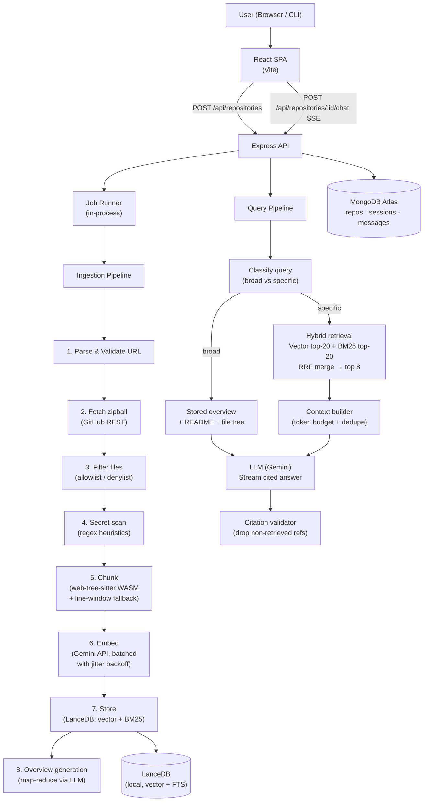

# RepoLens 🔍

> **Chat with any public GitHub repository.** Ask questions about code in plain English — get answers grounded in real file paths and line numbers, backed by hybrid semantic + keyword retrieval.

[](https://nodejs.org/) [](#license) [](#testing)

---

## What Makes This a Portfolio Project

RepoLens is built as an interview artifact demonstrating end-to-end RAG (Retrieval-Augmented Generation) engineering, not just a wrapper around an LLM. Every design decision is measurable:

| Differentiator | Implementation |
|---|---|
| **Syntax-aware chunking** | `web-tree-sitter` (WASM) splits code at function/class boundaries with symbol names and line ranges |
| **Hybrid retrieval** | Vector search + BM25 full-text search, merged with Reciprocal Rank Fusion (RRF, k=60) |
| **Incremental indexing** | GitHub compare API diffs commit SHAs; only changed files are re-embedded |
| **Measured RAG quality** | Evaluation harness computes Recall@5, Recall@8, and MRR across retrieval strategies |
| **Grounded answers** | Every claim cites `[filePath:startLine-endLine]`; un-evidenced questions get "insufficient context" |

---

## Architecture



### Component Map

```
RepoLens/
├── src/
│   ├── adapters/       github.js · embedder.js · llm.js · vectorStore.js
│   ├── ingestion/      parseRepoUrl · fileFilter · secretScanner · chunker · indexer · diffIndexer
│   ├── retrieval/      hybridSearch · contextBuilder
│   ├── generation/     prompts · answer · overview
│   ├── db/             mongo.js · models.js
│   ├── jobs/           runner.js  (in-process queue + crash recovery)
│   └── api/            server · routes · controllers · middleware
├── scripts/            index-repo.js · ask.js · eval.js
├── eval/               repos.json · questions.json · results.md
└── frontend/           React + Vite SPA
```

---

## Retrieval Benchmark

Evaluated on `expressjs/cookie-parser` (pinned commit) with 5 ground-truth question/file pairs.

| Retrieval Strategy | Recall@5 | Recall@8 | MRR |
|---|---|---|---|
| Vector-Only | 0.8000 | 1.0000 | 0.7333 |
| BM25-Only | 0.8000 | 1.0000 | 0.7000 |
| **Hybrid (Vector + BM25 + RRF)** | **1.0000** | **1.0000** | **0.9333** |

**Key finding:** Hybrid RRF boosts MRR by +20 points over Vector-Only and +23 points over BM25-Only. Queries that match exact code symbols (e.g. function names) gain from BM25 precision; semantically phrased queries gain from vector recall. RRF captures both.

Reproduce: `node scripts/eval.js` (requires a live indexed repo — see [Evaluation](#evaluation)).

---

## Prerequisites

| Requirement | Version / Notes |
|---|---|
| Node.js | 20+ (ES modules) |
| MongoDB Atlas | Free M0 cluster — [create one here](https://www.mongodb.com/cloud/atlas/register) |
| Gemini API key | Free via [Google AI Studio](https://aistudio.google.com/) — no billing required |

---

## Local Setup

### 1. Clone and install

```bash
git clone https://github.com/YOUR_USERNAME/RepoLens.git
cd RepoLens
npm install
```

### 2. Configure environment

```bash
cp .env.example .env
```

Edit `.env` and fill in every value:

```env
# MongoDB Atlas connection string (from Atlas → Connect → Drivers)
MONGODB_URI=mongodb+srv://<user>:<pass>@cluster0.xxxxx.mongodb.net/repolens?retryWrites=true&w=majority

# Gemini API key (Google AI Studio → Get API Key)
GEMINI_API_KEY=AIza...

# Model IDs — verify current free-tier names at aistudio.google.com
EMBEDDING_MODEL_ID=text-embedding-004
LLM_MODEL_ID=gemini-1.5-flash
EMBEDDING_DIMENSION=768

# Optional: increases GitHub API rate limit from 60 to 5000 req/hr
GITHUB_TOKEN=ghp_...

# Express server
PORT=3001
CORS_ORIGIN=http://localhost:5173
```

### 3. Set up tree-sitter WASM grammars

```bash
node scripts/setup-wasm.js
```

This copies the required `.wasm` grammar files into `wasm/` (JS, TS, Python, Java).

### 4. Start the backend

```bash
npm start
# → Express API running on http://localhost:3001
```

### 5. Start the frontend (separate terminal)

```bash
npm --prefix frontend install
npm --prefix frontend run dev
# → React SPA at http://localhost:5173
```

Open `http://localhost:5173`, paste any public GitHub URL, and start chatting.

---

## CLI Usage

All CLI tools can be used independently of the HTTP API.

### Index a repository

```bash
# Full index
node scripts/index-repo.js --index https://github.com/expressjs/cookie-parser

# Dry-run (lists files without embedding)
node scripts/index-repo.js https://github.com/expressjs/cookie-parser

# Incremental refresh (only re-embed changed files)
node scripts/index-repo.js --refresh --index https://github.com/expressjs/cookie-parser

# Show verbose chunking stats
node scripts/index-repo.js --index --verbose https://github.com/expressjs/cookie-parser
```

### Ask a question

```bash
node scripts/ask.js <repositoryId> "How is cookie signing implemented?"
```

`repositoryId` is printed after indexing, or can be retrieved from MongoDB.

### Run the evaluation harness

```bash
node scripts/eval.js
```

Indexes all repos in `eval/repos.json`, runs all questions in `eval/questions.json` under three retrieval strategies, and appends results to `eval/results.md`.

---

## API Reference

All endpoints are prefixed `/api`.

| Method | Path | Body | Response |
|---|---|---|---|
| `POST` | `/api/repositories` | `{ repoUrl }` | `202 { repositoryId, status }` — starts background indexing job |
| `GET` | `/api/repositories/:id` | — | `{ status, statusDetail, stats, overview }` |
| `POST` | `/api/repositories/:id/chat` | `{ question, sessionId? }` | SSE stream: `data: { token }` … `data: { done, citations }` |
| `POST` | `/api/repositories/:id/refresh` | — | `202` — queues incremental re-index |
| `GET` | `/api/repositories/:id/sessions/:sessionId` | — | `{ messages: [...] }` |

### Status lifecycle

```
queued → fetching → processing → indexing → ready
                                          ↘ failed
```

Poll `GET /api/repositories/:id` until `status === "ready"`.

---

## Testing

```bash
npm test
```

Runs 139 unit tests across 23 suites using Node.js built-in test runner (`node --test`). No additional test runtime needed.

Test coverage includes: URL parser, zip-slip protection, file filter rules, secret scanner, tree-sitter chunking, line-window fallback, embedder batching/backoff, LanceDB upsert/dedup, RRF merger, context builder token budget, citation validator, job runner crash recovery, API middleware, and SSE controller.

---

## Free-Tier Hosting

### Backend → [Render](https://render.com) Free Web Service

1. Push this repo to GitHub.
2. Create a **New Web Service** on Render, connect the repo.
3. Set **Build Command**: `npm install && node scripts/setup-wasm.js`
4. Set **Start Command**: `npm start`
5. Add all environment variables from `.env` in the Render dashboard.

> [!WARNING]
> Render free-tier instances **spin down after 15 minutes of inactivity** and take ~30 seconds to cold-start. The first request after a cold start will time out on the frontend — a "waking up…" message is the right UX pattern.

### Frontend → [Vercel](https://vercel.com) or [Netlify](https://netlify.com)

1. Set **Root Directory** to `frontend/`.
2. Set **Build Command**: `npm run build`
3. Set **Output Directory**: `dist`
4. Set **Environment Variable**: `VITE_API_URL=https://your-render-backend.onrender.com`

Both services have generous free tiers with no cold-start penalty for static sites.

### Data persistence on free tier

- **MongoDB Atlas M0**: Free forever, 512 MB storage — sufficient for dozens of indexed repos.
- **LanceDB**: Stored on local disk — **not** persistent across Render deployments. Repos must be re-indexed after each deploy. For persistence, mount a Render disk (~\$1/month) or use a free Railway deployment.

---

## Known Limitations

These are stated honestly for technical interviews:

1. **Public repos and default branch only.** Private repos and branch selection are v2 scope.
2. **Size cap enforced.** Repos > 50 MB archive, > 10,000 files, or files > 200 KB are rejected. Large monorepos will hit this limit.
3. **Free-tier rate limits slow indexing.** Gemini embedding API has requests-per-minute limits on the free tier; the embedder uses batching and jitter backoff, but a 500-file repo can take several minutes.
4. **LanceDB is local.** Horizontal scaling requires migrating to a hosted vector store (e.g. Pinecone, Weaviate, or MongoDB Atlas Vector Search).
5. **Answers can still be wrong.** Grounding and citations exist so users can verify claims — they don't guarantee correctness. The eval table quantifies retrieval quality, not answer accuracy.
6. **No re-ranking.** A cross-encoder reranker (e.g. Cohere Rerank free tier) could improve MRR further; excluded to stay zero-cost.
7. **Tree-sitter language coverage.** Currently supports JavaScript, TypeScript, Python, and Java. Other languages fall back to line-window chunking.

---

## Security Design

| Threat | Mitigation |
|---|---|
| SSRF | Strict URL allow-list: `github.com` only; no arbitrary URL fetching |
| Zip-slip | Path traversal check on every archive entry before extraction |
| Zip bomb | Total extracted size capped at 200 MB |
| Secret leakage | Files matching `.env*`, `*.pem`, `*.key`, `id_rsa*`, or containing AWS/JWT/API-key patterns are skipped before embedding or LLM calls |
| Prompt injection | System prompt instructs model to treat repo content as untrusted data and ignore embedded instructions |
| API key exposure | Keys only in `.env`; `.env` in `.gitignore`; never logged |

---

## Tech Stack

| Layer | Choice | Reason |
|---|---|---|
| Runtime | Node.js 20 (ES modules) | Zero-cost, no transpilation |
| Backend | Express.js | Minimal, well-understood |
| Frontend | React 18 + Vite | Fast dev server, small bundle |
| Embeddings | Gemini `text-embedding-004` | Free tier, high quality |
| LLM | Gemini `gemini-1.5-flash` | Free tier, streaming support |
| Vector store | LanceDB (local) | Zero infra, vector + BM25 in one |
| Metadata DB | MongoDB Atlas M0 | Free tier, Mongoose ODM |
| Chunking | `web-tree-sitter` (WASM) | Works on Windows without native builds |
| Testing | `node --test` | Built-in, no extra runtime |

---

## License

MIT — see [LICENSE](LICENSE) for details.
